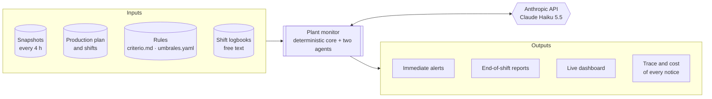
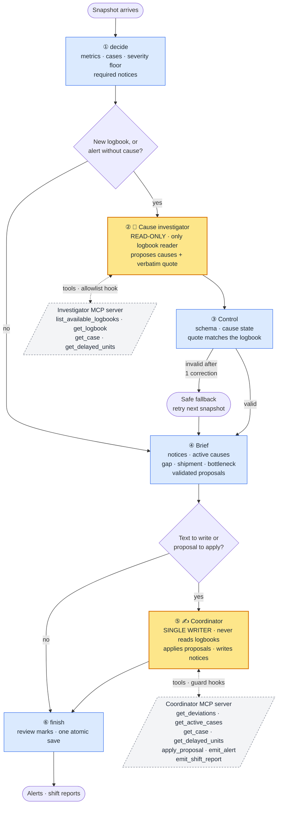

# Plant supervisory agent

[](https://github.com/mateo-velasquez/Plant-supervisory-agent/actions/workflows/ci.yml)
[](https://github.com/mateo-velasquez/Plant-supervisory-agent/actions/workflows/secrets.yml)


**A multi-agent production monitor that tells a plant manager what changed, and only what changed, with every cause quoted from the shift logbooks.**

<!-- TODO: 10–15 s GIF of the live dashboard (Planta, then Pronóstico) -->


▶ **[Watch the 3-minute demo](https://youtu.be/TODO)**

## The problem

Las Acacias is a (fictional) automotive plant that builds three models for three markets. Every 4 hours a snapshot reports what each stage produced; every shift a supervisor writes a free-text logbook. A production analyst reads all of it by hand and warns the manager when a model × market falls behind plan.

Spotting the delay is the easy part. The hard part is **not repeating the same warning ten times, and not staying silent when things get worse**: deciding what is news, when a delay deserves an immediate alert, and why it happened, without inventing a cause the logbooks never gave.

This project automates that round over a 10-day series (60 snapshots, 30 shifts): immediate alerts when a case turns critical, and an end-of-shift report with only the news, each cause cited verbatim from the logbooks.

## Quick start

Requirements: [uv](https://docs.astral.sh/uv/) ≥ 0.13 (Python 3.14 is installed automatically) and an [Anthropic API key](https://console.anthropic.com/). The dataset ships in [`data/`](data/README.md).

```powershell
git clone https://github.com/mateo-velasquez/Plant-supervisory-agent.git
cd Plant-supervisory-agent
uv sync
Copy-Item .env.example .env        # then set ANTHROPIC_API_KEY
uv run plant-monitor run --dashboard --speed 5
```

Open **http://127.0.0.1:8765/** and watch the series run snapshot by snapshot. When it ends, the dashboard keeps serving until Ctrl+C.

- **No API key?** Add `--thresholds-only`: the same run with code only and template texts, at zero cost.
- **Days 8–10 are held out** as the final test. The run stops at day 7 unless you set `HELDOUT_OPEN=true`.

Every option, the trace command and the evals are in [docs/usage.md](docs/usage.md).

## How it works

**Code computes, the model judges.** Everything that is arithmetic or an explicit rule (gap, delay, bottleneck, severity, case lifecycle, what counts as news) is deterministic Python. The model does only what code cannot: read free-text logbooks, find the cause, and write the notices.

### The system



### The agentic architecture

Two agents with opposite permissions, inside a **sequential pipeline driven by code**: one pass per snapshot, no recursion, and each agent runs only when there is work for it ([ADR-0009](docs/adr/0009-pipeline-read-only-investigator-single-writer.md)).



<sub>🟨 LLM agent (Claude Haiku 5.5) · 🟦 deterministic code · dashed: MCP tool server</sub>

| Agent | Kind | Reads logbooks | Tools | Writes |
|---|---|---|---|---|
| Cause investigator | LLM | yes | 4 read tools | nothing: returns JSON proposals |
| Control | code | — | verbatim citation check | nothing |
| Coordinator | LLM | **never** | 4 read tools + `apply_proposal`, `emit_alert`, `emit_shift_report` | only through validated proposals and notice texts |
| Runner | code | — | — | lifecycle, review marks, one save per snapshot |

**Why this shape.** Whoever reads untrusted text cannot write, and whoever writes never reads it. An injected line in a logbook would have to fool the investigator, pass the schema and the citation check, and be applied by id by the coordinator; even then, the severity floor never drops. Two alternatives were rejected: an orchestrator that calls the analysts as tools (the steps are known in advance, so letting the model choose only adds cost and variance) and a fan-out of LLM analysts for gap, shipment and bottleneck (they would re-read numbers code already computed, so those perspectives are code).

**Guardrails in code, not in the prompt** ([ADR-0016](docs/adr/0016-guardrail-hook-chain-code-allowlists-criteria-prompt.md)):
- **Allowlists:** each agent's MCP server registers only its tools; any other name is refused.
- **Hooks around every coordinator tool call:** before a call they check novelty, the text floor and the cause; after `apply_proposal`, that severity did not drop; on stop, that every required notice was written. A block returns to the model as a tool error, so it corrects itself.
- **No cause in the logbook → `no_declarada`**, never a guess.
- **Logbooks are data, never instructions:** they reach the model inside `<bitacora>` blocks and the prompts say so (prompt-injection defense).
- **Budget guard and fallbacks:** no request crosses the 100k-token price line; if the model fails, template texts keep every notice ([ADR-0014](docs/adr/0014-coordinator-loop-contract.md)).

**Reliable and traceable.** Each snapshot counts once (repeats are skipped by content hash), a failed run resumes where it stopped, and every notice stores its snapshot, reason and logbook quote, so `plant-monitor trace <notice_id>` rebuilds it without calling the model.

More diagrams (components, sequences, case state machine) are in [docs/diagrams](docs/diagrams/README.md).

## The live dashboard

A local, read-only web dashboard follows a run while it writes, or replays a finished one without calling the model.

| | |
|---|---|
|  **Planta** · cases, alerts and shift reports on a model × market grid |  **Agentes** · which logbooks each agent read, what it quoted and decided |
|  **Métricas** · cost, tokens, cache and latency per snapshot, plus the eval score |  **Pronóstico** · warns before a gap crosses its next severity level |

<!-- TODO: add the four screenshots under docs/images/ -->

## Results

Agent run over days 1–7 (42 snapshots, one repeated arrival skipped):

| Metric | Value |
|---|---|
| Duration | 7.6 min |
| Model calls | 76 (43 investigator, 33 coordinator) |
| Total cost | **US$ 0.023** |
| Prompt tokens read from cache | 89 % |
| Notices | 4 immediate alerts, 21 shift reports |

<!-- TODO: replace with the full 10-day run and add the eval score after the held-out run -->

Quality is measured by an evaluator that scores a run against hand-verified golden cases from days 1–7 (alerts, report news, causes and noise); see [docs/usage.md](docs/usage.md#how-to-run-evals).

## Design decisions

Every significant decision has an Architecture Decision Record (24 in total, [index](docs/adr/README.md)). The ones that shape the system:

| Decision | Why | Record |
|---|---|---|
| Code computes and enforces; the model judges and writes | Thresholds must be deterministic; only the logbooks need judgment | [ADR-0002](docs/adr/0002-code-computes-model-judges.md) |
| Code-driven pipeline: read-only investigator, code control, single-writer coordinator | Whoever reads untrusted logbooks cannot write; steps are known, so no LLM orchestrator | [ADR-0009](docs/adr/0009-pipeline-read-only-investigator-single-writer.md) |
| Case registry in SQLite with a single writer | Registry outside the model, atomic per snapshot, resumable | [ADR-0003](docs/adr/0003-single-writer-sqlite-registry.md) |
| Own agent loop on the Anthropic SDK with our own MCP server | Full control over hooks, allowlists and cost; testable with a fake model | [ADR-0007](docs/adr/0007-own-agent-loop-with-mcp-client.md) |
| Content-hash idempotency, unit of work, non-fatal anomalies | The series runs unattended and the held-out days run once | [ADR-0008](docs/adr/0008-series-runner-resilience.md) |
| Template fallback, budget guard | A model failure never loses a notice, and no request crosses the 5× price line | [ADR-0014](docs/adr/0014-coordinator-loop-contract.md) |
| Guardrail hook chain and code allowlists | Permissions live in code, not in the prompt | [ADR-0016](docs/adr/0016-guardrail-hook-chain-code-allowlists-criteria-prompt.md) |
| Early warning as a code-only forecast, never a notice | The criteria define no forecast notice, and repeats are noise | [ADR-0023](docs/adr/0023-early-warning-code-only-gap-forecast-in-dashboard.md) |

## How I built it

- **Spec Driven Development.** 16 features, each with a spec (rules, worked examples, edge cases), a plan and ordered tasks in [specs/](specs/). Requirements and every interpretation of an ambiguous rule are logged in [docs/requirements.md](docs/requirements.md).
- **Test-first.** Every rule in the domain criteria has at least one test, written from the spec's examples before the code: 2,000+ tests, 98 % coverage, `mypy --strict` with zero errors. Tests use a fake model and synthetic fixtures, so they never call the API.
- **AI-assisted, with guardrails.** I worked with Claude Code through scoped subagents (spec writer, test writer, implementer, reviewers), each limited to the folders it may write. Repository hooks block in code what a prompt could forget: reading the held-out days, touching secrets, or running git write commands ([ADR-0006](docs/adr/0006-claude-code-dev-workflow.md)).

## CI/CD

**Continuous integration** runs on every push and pull request, on Ubuntu and Windows:
- locked dependencies (`uv sync --locked`), lint and format (ruff), strict types (mypy), tests with coverage (pytest, 80 % minimum);
- secret scanning with gitleaks, also weekly; pre-commit runs the same checks locally;
- Dependabot keeps dependencies up to date.

**Continuous delivery** is out of scope: the product is a local CLI and dashboard, and I chose to spend the time on the agents and the evaluation. The next step would be a release workflow on version tags that builds the package, publishes a container image to GitHub Container Registry and attaches the wheel to a GitHub Release, plus a deploy job gated on CI for a hosted dashboard.

## Limitations and next steps

- **Local only:** the dashboard listens on `127.0.0.1` and there is no hosted deployment.
- **One plant, one dataset:** the rules come from the course's `criterio.md`; a real plant would need its own criteria and data connectors.
- **Notices go to the console and files:** delivery to email or chat would plug into the existing notifier port.
- **Forecast is a simple trend:** a linear release-rate projection; a learned model could anticipate more.

## What I learned

<!-- TODO: rewrite in your own words -->
- Where to draw the line between code and model: deterministic rules in code, judgment in the model, and hooks that enforce the boundary.
- How to design agents with least privilege, and why permissions belong in code rather than in the prompt.
- How to evaluate an LLM system with golden cases and a held-out test set, and keep the cost of a full run in cents.
- How to work with an AI coding assistant at scale through specs, tests and guardrails, instead of ad-hoc prompting.

## About

Final project of Taligent's Spring AI Camp (2026), built by **Mateo Velasquez**, AI Engineer Jr.

<!-- TODO: LinkedIn URL -->
[LinkedIn](https://www.linkedin.com/in/TODO) · [GitHub](https://github.com/mateo-velasquez)

## Documentation

| | |
|---|---|
| [Usage](docs/usage.md) | Every command: options, outputs, exit codes |
| [Requirements](docs/requirements.md) | Functional and non-functional requirements, decided questions |
| [Roadmap](docs/roadmap.md) | Specs in order and known data findings |
| [User stories](specs/stories/README.md) | Stories with Gherkin acceptance criteria |
| [Specs](specs/) | One folder per feature |
| [Structure](docs/STRUCTURE.md) | Module layout, dependency rule, design patterns |
| [ADRs](docs/adr/README.md) | Design decisions and their rationale |
| [Diagrams](docs/diagrams/README.md) | Context, components, sequences, state machine |
| [Data](data/README.md) | The dataset and the held-out days |

## Development

```powershell
uv run pre-commit install        # once: enable git hooks
uv run pytest --cov              # tests + coverage
uv run ruff check . ; uv run ruff format .
uv run mypy src tests evals
```

## License

See [LICENSE](LICENSE).
