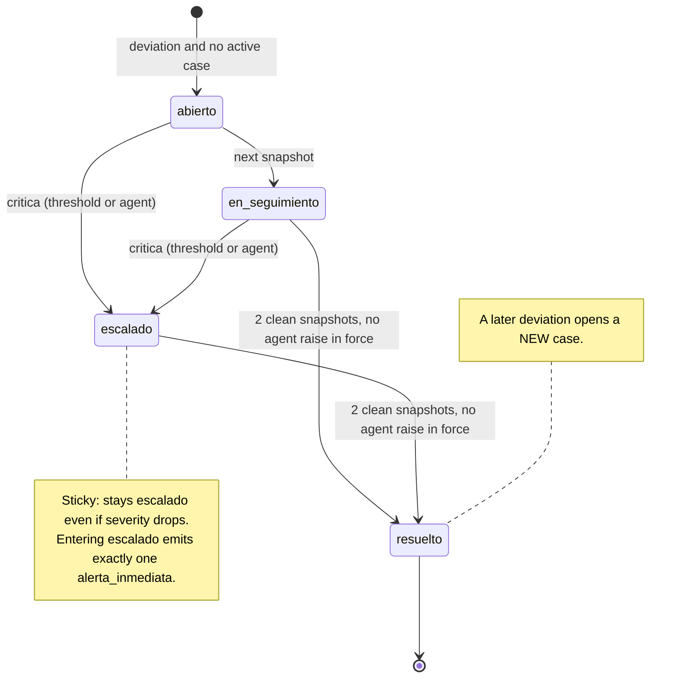

# Case state machine (§3)

## Rules not visible in the diagram
- At most one active case (`abierto`, `en_seguimiento` or `escalado`) per combination.
- For novelty, `abierto` and `en_seguimiento` count as the same state.
- Severity never goes below the computed minimum. The agent may only raise it.
- Whether `abierto` can resolve directly is not stated in §3; we assume it cannot, because it moves to `en_seguimiento` first.
- A case that opens already at `critica` opens and escalates in the same snapshot, and its alert fires there (Q-08 in the requirements).
