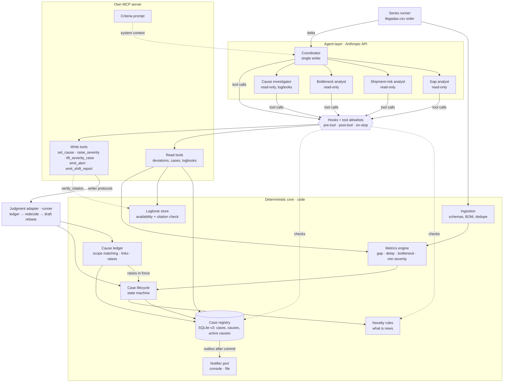

# Components

## Responsibilities
- **Deterministic core:** computes everything that is arithmetic or an explicit rule. It never calls the model.
- **MCP server:** the only door between agents and data. Tools return compact, filtered views, never full datasets.
- **Coordinator:** the only agent whose allowlist includes write tools. It decides cause, escalation and wording. It runs at every closing snapshot and at any snapshot with a text to write (ADR-0015).
- **Cause ledger and judgment adapter:** code links cases to an active cause by scope (model + stage, market if named; Q-02, Q-49) and feeds the raises to the lifecycle. Each judgment write re-runs `track` (Q-27) and rebuilds the notices; they are saved once per snapshot (ADR-0015).
- **Analysts:** read-only specialists, introduced in W3. In W1 the coordinator works alone.
- **Hooks:** code that runs around every tool call. They enforce the severity floor, block repeats without news and check report completeness, returning violations to the model as tool errors.
