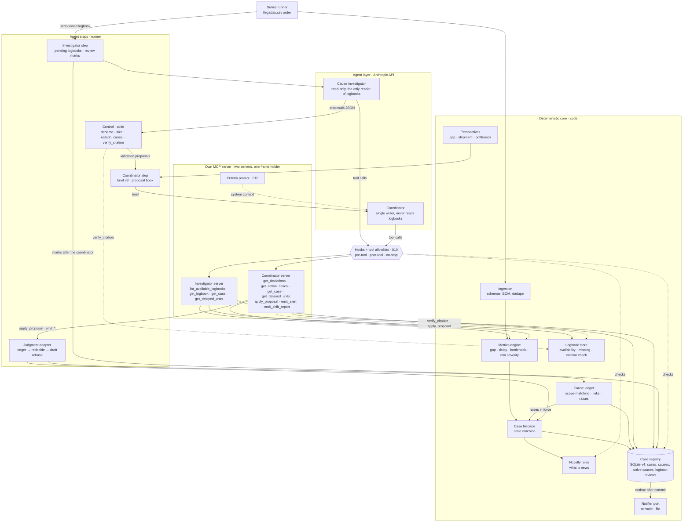

# Components

## Responsibilities
- **Deterministic core:** computes everything that is arithmetic or an explicit rule, including the gap, shipment and bottleneck perspectives of the coordinator brief (Q-50). It never calls the model.
- **MCP server:** the only door between agents and data. Each agent gets its own server with only its tools; both share one frame holder on the runner's thread (ADR-0009, ADR-0013).
- **Cause investigator:** the only agent that reads logbooks. It runs when a readable logbook is neither reviewed nor given up (Q-51, Q-52), has no write tool and returns typed proposals with citations.
- **Control:** code checks each proposal (schema, size, `estado_causa` against the type, verbatim and readable citation), with one correction round and a safe fallback.
- **Coordinator:** the single writer. It never reads a raw logbook; it applies validated proposals by id (`apply_proposal`) and writes the texts. It runs only with a text to write or a validated proposal (Q-51).
- **Cause ledger and judgment adapter:** code links cases to an active cause by scope (Q-02, Q-49) and feeds the raises to the lifecycle. Each judgment write re-runs `track` (Q-27) and rebuilds the notices; they are saved once per snapshot (ADR-0015).
- **Hooks (spec 010):** code around every tool call. They enforce the allowlists, the severity floor, no repeats without news and report completeness, returning violations to the model as tool errors.
