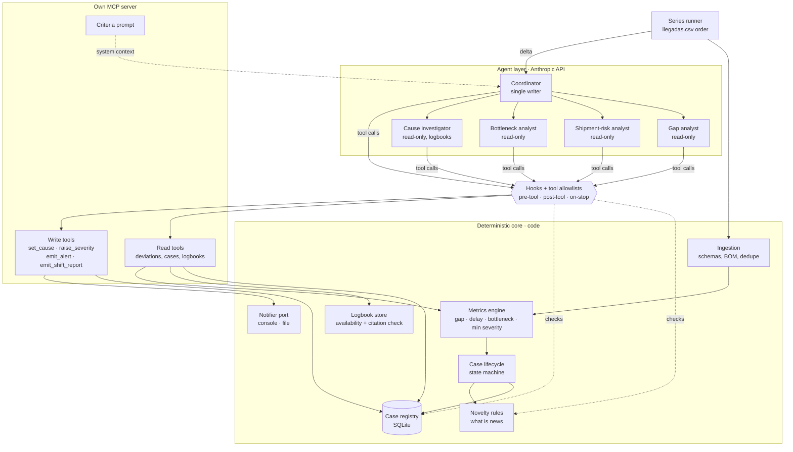

# Components

## Responsibilities
- **Deterministic core:** computes everything that is arithmetic or an explicit rule. It never calls the model.
- **MCP server:** the only door between agents and data. Tools return compact, filtered views, never full datasets.
- **Coordinator:** the only agent whose allowlist includes write tools. It decides cause, escalation and wording.
- **Analysts:** read-only specialists, introduced in W3. In W1 the coordinator works alone.
- **Hooks:** code that runs around every tool call. They enforce the severity floor, block repeats without news and check report completeness, returning violations to the model as tool errors.
