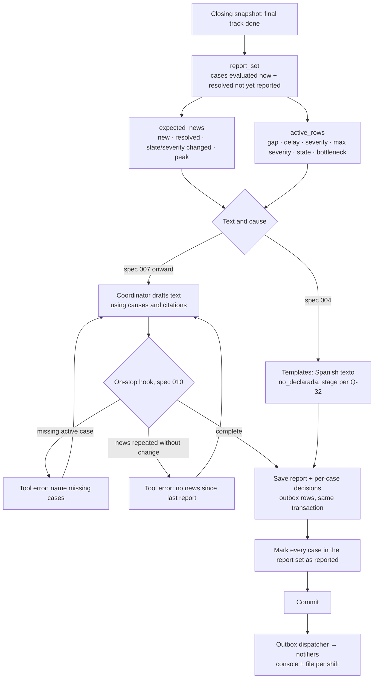

# Shift close

The code decides **which** cases are news and which are active. Until spec 007 it also writes the text. From spec 007 on, the agent decides **how** to say it, and the hook makes sure the agent's report matches the code's expectation exactly.

- A case gets one decision per snapshot: `alerta_inmediata`, `informe_de_turno` (news) or `sin_aviso` (unchanged since its last report, §4). A case that escalates at the closing snapshot gets both the alert and its news entry.
- Only cases in the report are marked. A case already reported as resolved is never marked or reported again.
