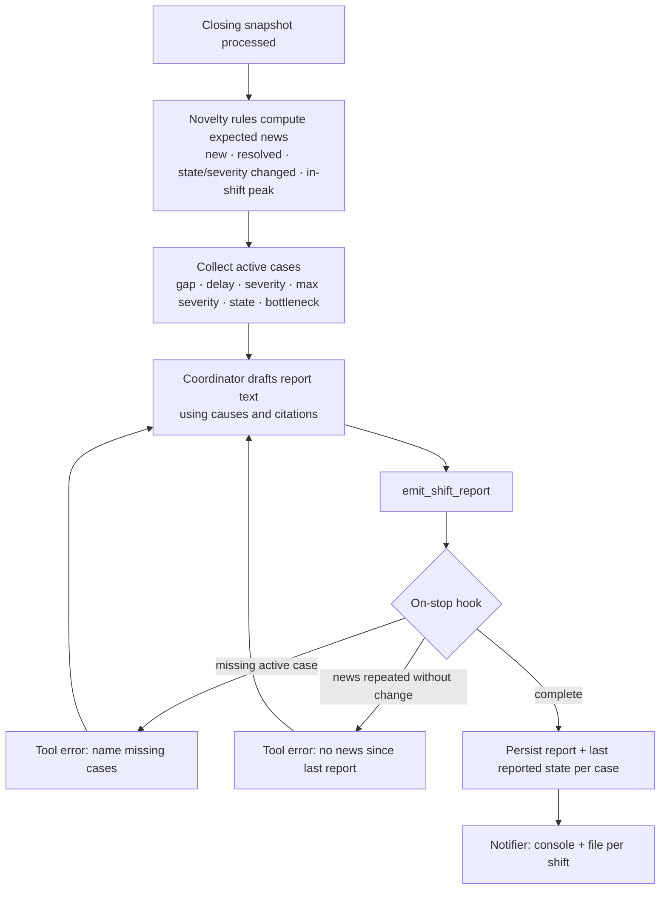

# Shift close

The code decides **which** cases are news and which are active, and the agent decides **how** to say it. The hook makes sure the agent's report matches the code's expectation exactly.
