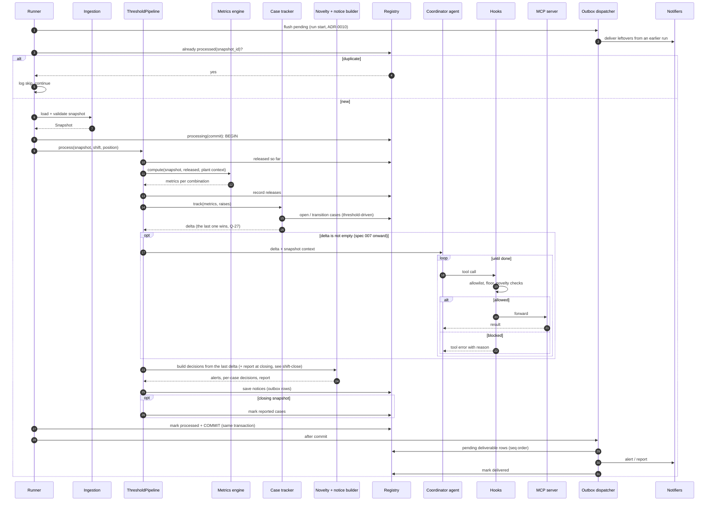

# Processing one snapshot

## Notes
- Threshold-driven transitions happen in code before the agent runs, so the agent starts from the true state.
- If the delta is empty and it is not a closing snapshot, no model call is made. Silence costs nothing. Until spec 007 the pipeline runs without the agent.
- Notices are stored inside the snapshot's transaction and delivered only after the commit (ADR-0010). A crash after the commit leaves them pending, and the next run delivers them first. A notice can be resent only if the process dies between a send and its delivered mark.
- Marking the snapshot as processed is atomic with its writes, which makes reruns safe (FR-02, NFR-10).
