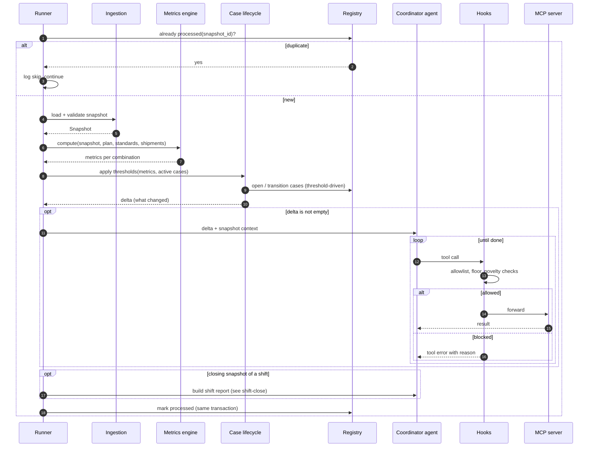

# Processing one snapshot

## Notes
- Threshold-driven transitions happen in code before the agent runs, so the agent starts from the true state.
- If the delta is empty and it is not a closing snapshot, no model call is made. Silence costs nothing.
- Marking the snapshot as processed is atomic with its writes, which makes reruns safe (FR-02, NFR-10).
